# Court Feel

> ### True to the court.

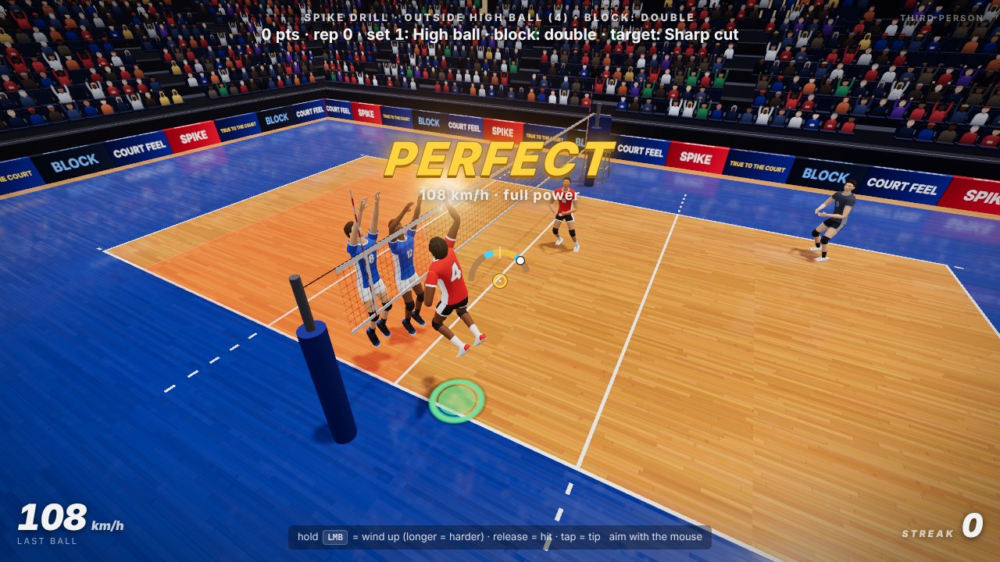

A browser-based 3D volleyball **feel** sandbox. Not a full game: a polished,
replayable set of drills built around the core moments of the sport —
approach, plant, jump, spike, block, set, pass and dig — in first or third
person, with timing that is graded, contacts that feel earned and Perfect
spikes that explode.

**▶ Play it: [court-feel.jackzxq.dev](https://court-feel.jackzxq.dev)**. It runs on
a computer (mouse and keyboard) or a phone (hold it sideways).

> **Alpha.** Court Feel is being played at our volleyball club first. Expect
> rough edges, and when something doesn't feel like the court,
> [tell us](https://github.com/LemonPhase/court-feel/issues/new?template=feel-report.yml).

Built with TypeScript, Vite and three.js. Everything you see and hear (the
athletes, their animation, the arena, the sounds) is generated by code — see
[CREDITS.md](CREDITS.md).

## The principle

**True to the court.**

Court Feel is measured against one thing: a real volleyball court. Every
timing window, ball flight, set call, sound and camera has to pass one
question: *is it true to the court?* In other words, would someone who has
played on a real court recognise it? Fun but wrong is a bug, and we keep
working on it until it's fun and right. In practice:

1. **The real sport sets the numbers.** A regulation court and net, a 270 g
   ball with real drag and topspin, sets at real tempo: a middle's quick
   leaves the floor on the setter's touch, as it does in the gym. When we bend
   a number to make it playable (the back set is a little higher than elite
   tempo), we write down why.
2. **The skill is the volleyball skill.** You are graded on what a coach
   grades: when you start the approach, when you leave the floor, when the arm
   comes through, whether your platform is ready. Controls follow the body:
   hold to load the plant, hold to draw the arm back, release to swing.
3. **The physics is honest.** The ball goes where your contact sends it, and
   the simulation, not a script, decides whether it clears the net. Aim assist
   only helps your body (a little reach, a gentle drift towards the ball). You
   can see it in the settings, and at 0 it is off.
4. **Effects amplify, they never replace.** A Perfect spike gets a freeze
   frame, sparks and a floor boom because that is how it feels, and all of it
   scales with how well and how hard you hit. Nothing hides the ball, and
   there are no full-screen flashes.
5. **Players are the judge.** Changes to the feel get played before they
   ship. "That's not how it feels on a real court" is a valid bug report.

Every pull request answers one question for each of these rules, and
[AGENTS.md](AGENTS.md) is the working guide for anyone changing the code.

## Screenshots

Real frames from the game: no paint-overs, no staged cameras.

<table>
  <tr>
    <td width="50%" valign="top">
      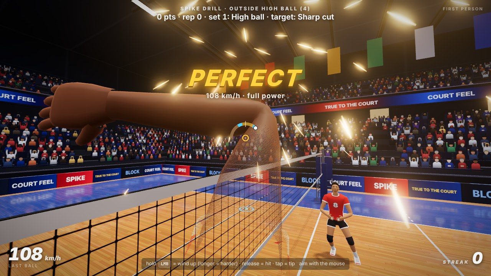
      <b>From your own eyes.</b> A Perfect, full-power spike in first person: the arm comes through and the ball leaves at 108 km/h.
    </td>
    <td width="50%" valign="top">
      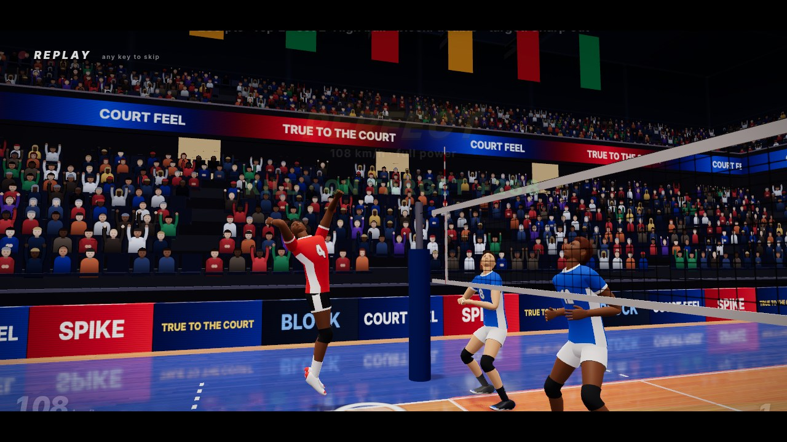
      <b>The replay.</b> Perfect spikes play back in slow motion from a broadcast camera. R replays your last attempt, misses included.
    </td>
  </tr>
  <tr>
    <td width="50%" valign="top">
      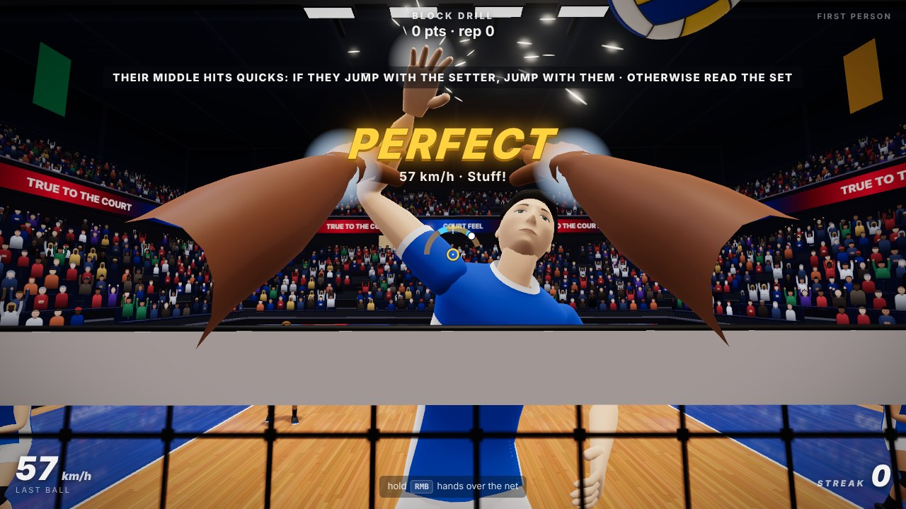
      <b>At the net.</b> Read the set, time the jump, press over. A stuff block, seen through the blocker's eyes.
    </td>
    <td width="50%" valign="top">
      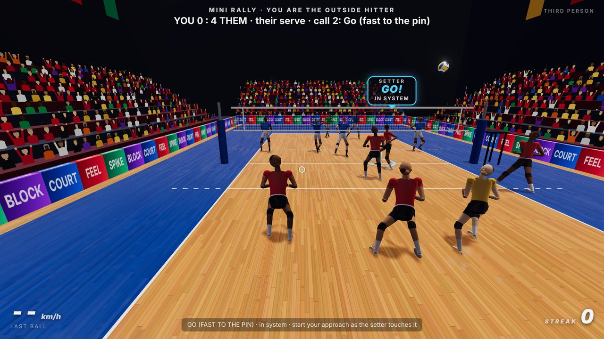
      <b>The setter calls the pass.</b> 6 v 6 in your position. A second before the set, the setter calls the pass: GO! when it's on, HIGH! when it's out of system.
    </td>
  </tr>
  <tr>
    <td width="50%" valign="top">
      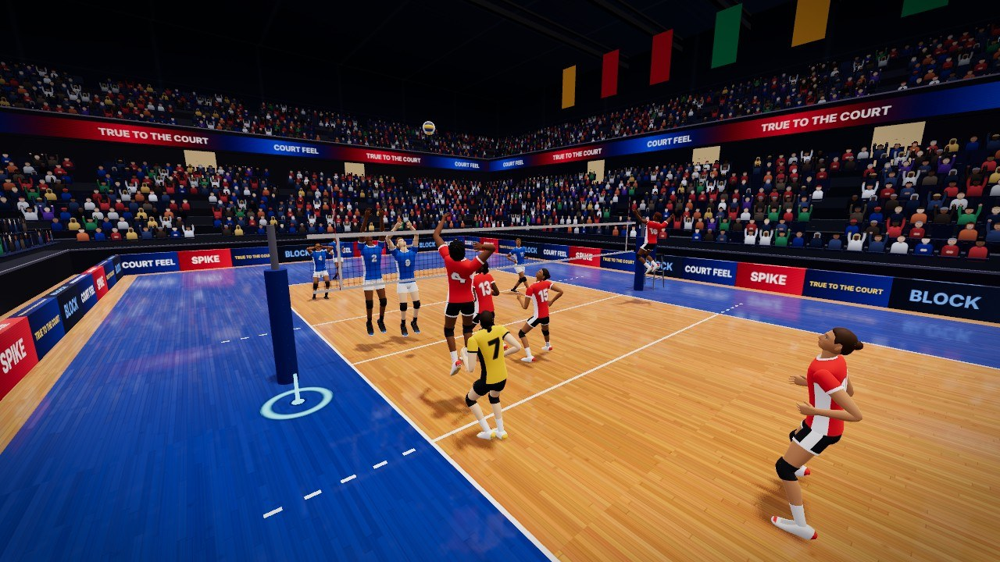
      <b>Their middle closes.</b> It reads the set and closes on its pin blocker, hands to hands. Late, it drifts in to their shoulder and stretches for the seam.
    </td>
    <td width="50%" valign="top">
      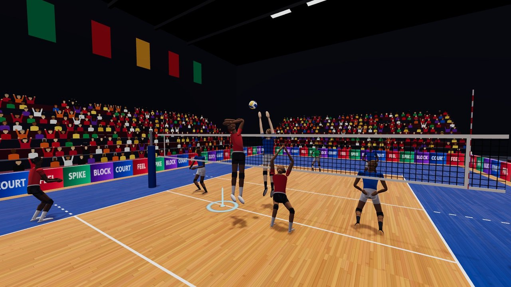
      <b>Guessing on the quick.</b> Off a good pass their middle sometimes commits: up with your middle as the setter touches it. Set the pin and they're caught.
    </td>
  </tr>
  <tr>
    <td width="50%" valign="top">
      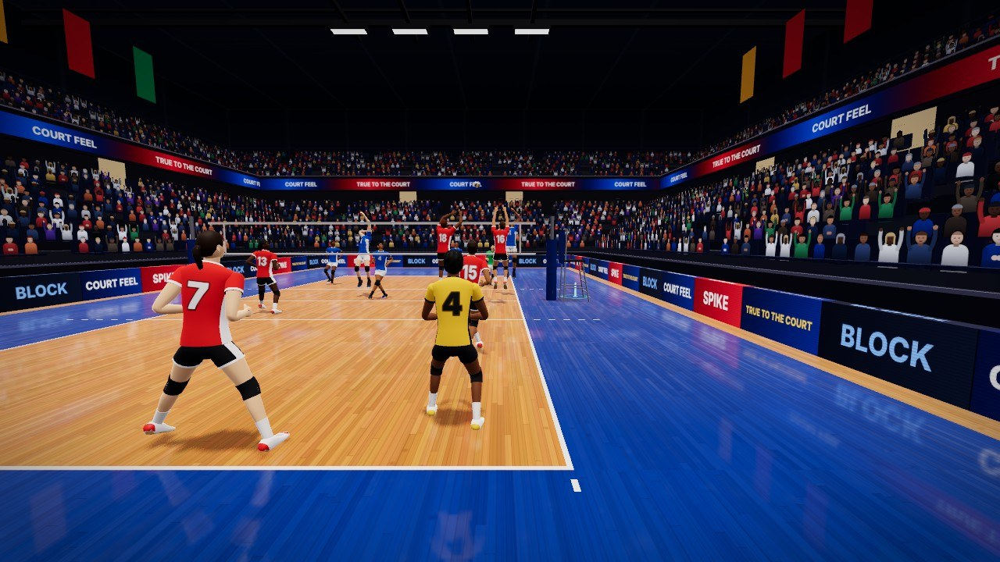
      <b>The split step.</b> As their hitter swings, the defence hops and lands on the contact. Team-mates give way to whoever plays the ball.
    </td>
    <td width="50%" valign="top">
      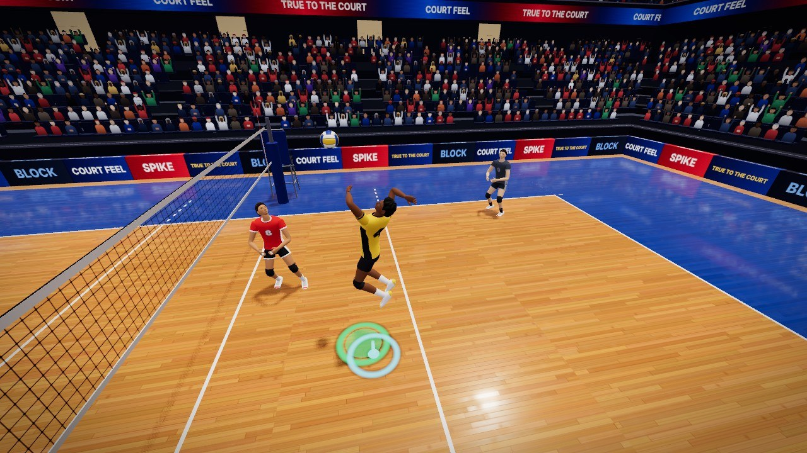
      <b>The pipe.</b> In system it's met 2 m off the net: take off behind the 3 m line and broad-jump in.
    </td>
  </tr>
  <tr>
    <td width="50%" valign="top">
      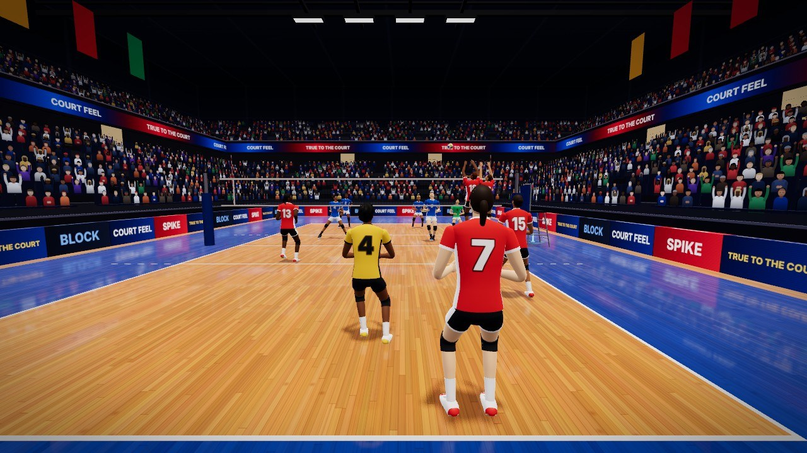
      <b>The defence reads the set.</b> Perimeter defence as their outside swings: the line, the cross, deep at the end line, and the off-blocker off the net for tips.
    </td>
    <td width="50%" valign="top">
      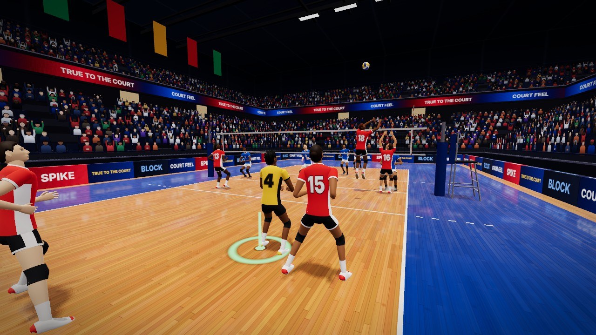
      <b>Early transition.</b> A soft block the libero will pass easily: the setter is already running to the net and the hitters are off it before the pass.
    </td>
  </tr>
  <tr>
    <td width="50%" valign="top">
      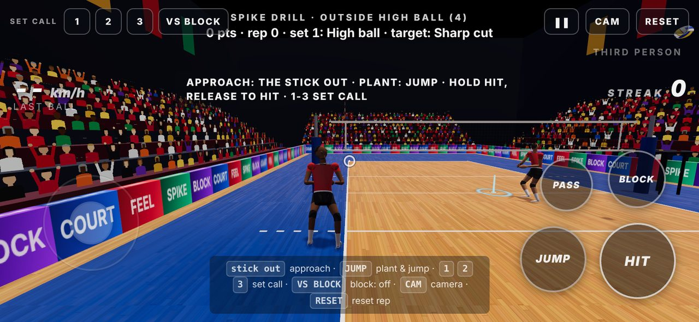
      <b>On your phone.</b> A joystick for your feet, drag to aim, hold to jump and hold to swing. The timing windows are the same as on a keyboard.
    </td>
    <td width="50%" valign="top">
      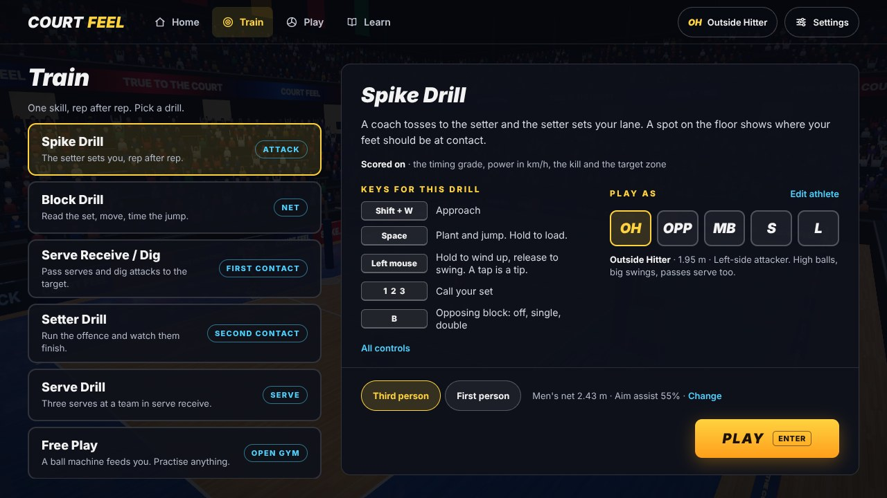
      <b>Pick a drill.</b> Each drill shows what it scores, its own keys and the position you play it as.
    </td>
  </tr>
</table>

## Run it locally

Needs Node 22 (see `.nvmrc`; `nvm use` picks it up).

```bash
npm install
npm run dev        # http://localhost:5173
```

```bash
npm run build      # typecheck + static build in dist/ (open with any static server, e.g. npm run preview)
npm run check      # typecheck, lint, formatting and unit tests: run this before pushing
npm run e2e        # end-to-end check in headless Chromium (see Testing)
npm run format     # format the code with Prettier
```

The start screen has four sections:

| Section | What is there |
|---|---|
| **Home** | One press back into your last drill and position (**Continue**). On a first visit: the tutorial. |
| **Train** | The five drills. The one you pick shows what it scores, its own keys and **Play as** (your position). |
| **Play** | The games: Mini Rally today. Sets and full matches will go here. |
| **Learn** | The tutorial, and every control for the keyboard and for touch. |

Pick a drill and click **PLAY** (or press Enter); the game captures the mouse
(pointer lock). **Esc** pauses: the pause menu shows the keys of the drill you
are in, the view, sensitivity and volume, and opens the settings. **Athlete**
and **Settings** are at the top right of every section.

On a first visit Home offers the lesson: **Start the tutorial**, or
**Skip to the drills**. (Someone who left part-way is offered the rest:
**Continue the tutorial**.) After that Home is **Continue**, PLAY always plays
the drill you picked, and the lesson can be taken again under **Learn**.

The lesson teaches one Outside spike in three balls, with less help each time. A strip names the four parts (**RUN › JUMP › DRAW ›
HIT**) and a cue under the action shows the one key to hold now.

1. **Together: the ball waits for you.** At each moment (run, jump, draw the
   arm, hit) time eases down and stops until you do it. Do it on time and
   nothing stops. A button you are already holding when its moment comes
   counts, so you never have to let go and press again. The coach holds your
   line to the spot and aims the ball; you hold the keys.
2. **Slow motion: you drive.** The same cues, slowed down. Nothing waits and
   the result is real.
3. **Full speed.** The drill as it is played.

After each ball the coach says one thing about it: the first thing that went
wrong, or that it was right. A rep that didn't come off is taken once more,
then the lesson moves on anyway. After the third ball the game stops and says
the tutorial is done: **Keep hitting** carries on in the Spike Drill you are
standing in, **Choose another drill** goes to Train (the tutorial stays under
Learn). On the floor, arrows lead from your start
down the run, a line marks where to plant (the jump carries you forward from
it), and a spot marks where you hit from. The line and the spot turn green
under your feet.

**Skip tutorial** is in the corner the whole time (and in the pause menu),
including while the mouse is locked. It is remembered in this browser
(`courtFeel.tutorial.v1`: `done`, `skipped`, or `in_progress:` plus the step);
taking it again once it is done or skipped changes nothing. The lesson is
under **Learn** on the start screen (**Take it again**). The lesson does
not teach the tip (a tap of the attack button) or aiming. First and third
person both stay available (V).

In the air, a collar around the charge ring shows where a release *now*
would land: gold is Perfect, cyan is Good, wood is early or late. It follows
Settings → Hints, which is on by default.

## Controls

| Input | Action |
|---|---|
| Mouse | Look (first person) / orbit (third person). Aim = where you look. |
| W A S D | Move (accelerates and decelerates; forward is fastest, backpedal slowest) |
| Shift | Approach / sprint |
| Space | Plant and jump. **Hold** to load a stronger jump, release to take off (auto at 0.3 s) |
| Left mouse | Attack. **Press and hold** to wind up (the arm draws back and a ring around the crosshair fills: the longer you hold, the harder the hit, full power at ~0.3 s), **release** to swing — timing is graded on the release: Perfect from about 0.12 s to 0.025 s before the ball reaches your hand (a fully drawn arm comes through a touch faster), Good on either side, and the late side is the forgiving one: releasing just as the ball arrives is still Good. A quick **tap** = tip (short) or roll shot (deep). Landing without releasing drops the swing. Also hits your serve. |
| Right mouse | Block (hands up, they press over the net in the air). When the ball is dropping onto you from your own side it **sets** instead — look at the hitter you want. |
| E | Bump / pass / dig (press early so the platform is ready; hold it) |
| Q | Serve toss (Free Play, feed 5 = serve practice), then hold and release Left mouse to hit — standing = float serve, jump = topspin serve |
| V | Toggle first / third person instantly, any time (even mid-rally) |
| R | Replay your last attempt in slow motion once the ball is dead: a clean contact, a poor one, a swing or a block that found no ball, or a ball that was yours and dropped untouched. Any key skips it; the game carries on where it was. |
| N | Reset / skip the current rep (Mini Rally: re-serve) |
| 1 / 2 / 3 | Spike Drill and Mini Rally: set call for the next ball (outside, middle, opposite — see below) |
| B | Spike Drill: opposing block off / single / double, with its shadow drawn on their floor (see below) |
| Esc | Pause / settings |
| F3 | Debug overlay: FPS, physics step time, ball state, timing window, contact gizmos |
| Free Play only | 1-5 feed type (set / free ball / float serve / hard attack / **serve practice**), F feed now, T auto-feed |

### Touch (phone / tablet)

On a touch screen the game switches to on-screen controls (Settings → Touch
controls: Auto / On / Off; `?touch=1` forces them on a desktop for testing).
Every touch goes through the same input path as the keys, so the timing
windows, the hold-to-load jump and the hold-to-charge swing are identical.
Hold the phone sideways.

| Touch | Action |
|---|---|
| Left thumb | A joystick appears where you touch. Deflection = speed; push it out to the ring (it turns gold, **RUN**) to approach / sprint. |
| Right thumb, drag anywhere | Look / aim, exactly like the mouse (Settings → Touch aim sensitivity). |
| **JUMP** | Hold to load, release to take off (auto at 0.3 s). Roll the thumb from JUMP onto HIT without lifting: you take off and the wind-up starts. |
| **HIT** | Hold to wind up (the ring around your thumb fills), release to swing, tap = tip. Drag while holding to aim. While you are loading or in the air, **the whole right half of the screen is HIT**, so the thumb does not have to find the button after the jump. |
| **BLOCK** | Hands up and load a jump; release to take off. The hands stay up until you land. When the ball is dropping onto you from your side the button reads **SET** and sets instead (no jump). |
| **PASS** | Hold: platform ready. |
| **TOSS** | Serve toss (Free Play). |
| Top right | Pause, camera toggle, reset rep, and REPLAY when your last attempt can be watched again. Top left: set calls (Spike Drill, Mini Rally), the opposing block toggle (Spike Drill) or feed types (Free Play). |

Haptics (Android) tick at full charge and on a graded contact. Tunables are in
`TOUCH` in `src/config.ts` (stick radius, run threshold, look scale, the
"right half is HIT in the air" and "roll from JUMP to HIT" behaviours).

### Aiming

Direction is your look direction. Depth is your pitch: look **lower** for a
sharp, short shot, **higher** to hit deep into the corners. A red ring on the
floor shows the target while you are loading or in the air. In first person
the range is set so that looking at the ball while you hit gives a mid-court
shot.

## Positions

Pick one in a drill's panel (**Play as**) or under **Athlete**. It changes your height, jump, approach speed,
power and ball control, where drills start you, and what the AI asks of you.

| | Height | Jump | Specialty |
|---|---|---|---|
| **Outside Hitter (OH)** | 1.95 m | 0.86 m | High ball to the left pin, passes serve |
| **Opposite (OPP)** | 1.99 m | 0.90 m | Biggest jump and power, back sets to the right pin |
| **Middle Blocker (MB)** | 2.04 m | 0.82 m | First-tempo quick (jump as the setter touches the ball), blocks along the net |
| **Setter (S)** | 1.90 m | 0.74 m | Sets every second ball, attacks on two |
| **Libero (L)** | 1.82 m | 0.66 m | Fastest feet and cleanest passing (back-row pipe in the spike drill) |

### Your athlete (hitting hand, custom height, vert and spike power)

**Hitting hand: Right / Left** (one setting for every position): a lefty spikes,
tips, rolls and serves with the left hand. The contact point moves in front of
the left shoulder, and with it the cyan feet ring, the quick set to a middle
and the autopilot. The wind-up turns the left shoulder back, the two-step plant
is left-right, the serve is tossed with the right hand, and the third-person
camera sits over the left shoulder. Passing, setting and blocking use both
hands and don't change. Timing windows, power and reach are the same for both
hands. The AI players stay right-handed.

**Athlete** (top right of the start screen, and from Settings) lets you make
each position your own. Its cards show every position's jump, speed, power and
control in real units: gold is the best of the five, cyan is strong, grey is not
that position's job, and the bars follow your sliders. Pick the position card
and set your **height** (1.60–2.20 m), **vertical jump** (your
approach jump, 40–110 cm; the standing jump keeps the position's fraction of
it) and **spike power** (shown as the top speed of a Perfect, full-power
spike, about 65–140 km/h; it also drives your serve speed). The panel shows
the spike reach that gives you and the position's defaults, and a reset.
Height moves everything that hangs off your body: reach and contact point,
the set heights, block height, the camera and your model. Changes apply right
away, even from the pause menu mid-drill, and the position cards on the start
screen show them. Only your player uses them; AI players keep the defaults.

## Modes

1. **Free Play** — a ball machine feeds you (set, free ball, float serve, hard
   attack). Spike, pass, block, set or serve your own. Feed **5** is serve
   practice: you start behind the end line, toss with Q and hit with the left
   mouse (jump for a topspin jump serve) at a target zone.
2. **Spike Drill** — a coach tosses to the setter, the setter sets your lane.
   Score = timing grade + power (km/h) + kill + hitting the highlighted target
   zone. A spot on the floor shows where your feet should be at contact (it
   turns green when you are on it). As the middle
   you hit a real quick: run in as the pass goes up and leave the floor as the
   setter touches the ball — the set is sent to where your hand will be at the
   top of your jump (jump late and the quick comes to the usual spot, too fast).
   Keys **1 / 2 / 3** call the set:

   | | 1 | 2 | 3 |
   |---|---|---|---|
   | Outside | High ball to the pin | Go: fast and flat to the pin | 3 ball: run inside, hit between middle and pin |
   | Middle | 1: quick in front of the setter | Shoot (31): out towards the outside, fired flat | Back quick: behind the setter |
   | Opposite | Back set to the pin | Fast back set | Back 2: close behind the setter |

   For fast sets the GO cue comes off the pass, because the run has to start
   before the setter touches the ball. Target zones follow your position: line
   and cross are mirrored for the opposite, and the middle aims at zone 1 or 5.

   Press **B** to practise hitting around a block: **single** puts an opposing
   blocker in front of your lane, **double** adds their middle closing next to
   them. They read the set and jump like the AI blockers in the rally. The
   **block shadow** is drawn in red on their floor: everything a straight ball
   from your contact point would hit into the hands, updated live as the block
   forms, so you can see the line, the cross and the seam opening up, and how
   deep a ball has to go to clear the top. A stuffed ball scores **BLOCKED**
   (0, streak lost); a ball off their hands that goes out or over scores
   **TOOLED** (timing points + 50); a kill past the block scores as usual.
3. **Block Drill** — the opponent setter sets one of three hitters. Every rep
   starts at the net in front of their middle; read the set, shuffle, hands up,
   time the jump. The hitter your position blocks in a match (outside: their
   opposite, opposite: their outside, middle: their middle) gets the most sets.
   Stuffs, soft blocks and touches score.
   Their middle runs a quick on every ball: to stop it, jump with them
   (commit) — if the set goes outside, you were fooled by the decoy.
4. **Serve Receive / Dig** — float serves and attacks come at you; pass to the
   green setter target. Passes are rated 0–3; your setter and hitter finish
   good passes.
5. **Setter Drill** — passes come in; look at a hitter (outside, quick, back
   set — the target ring lights up) and press right mouse as the ball drops.
   Your hitters attack against a live blocker.
6. **Mini Rally** — 6 v 6 with you in your position. The AI receives, sets
   (often to you), attacks, blocks and digs: AI defenders also dig to the side,
   pass slow balls overhand and dive for balls they can't reach on foot. After
   every block the front row gets off the net to approach (unless the block sent
   the ball back over), and the team covers its hitter low, in the real
   coverage spots. A soft ball into a well-formed block can come back off the
   hands for the cover to dig up and attack again (out of system), and the AI
   never misses a serve (yours still can). Win or
   lose the point. "Your ball!"
   and a green landing marker tell you when the ball is yours. As a hitter
   (OH, MB, OPP) keys **1 / 2 / 3** call your set, the same calls as in the
   Spike Drill: press before the setter touches the ball; the call sticks
   until you change it (1 is your position's default). Fast calls (go, fast
   back) need you running as the setter touches the ball; a quick goes to
   where you jump.

   **The setter calls the pass.** About 0.2 s after every pass or dig your
   setter reads where they will take it and calls it, in a bubble over their
   head (an arrow at the screen edge when they are behind you) and out loud,
   about a second before they touch the ball:

   | Call | Means |
   |---|---|
   | **HIGH!** (orange) | Out of system: the pass is too far off the net. Everything goes up high: no quick, and a called go / 3 / fast back / back 2 becomes a high ball. Wait for it. |
   | **GO!**, **1!**, **FAST!**... (cyan) | In system, and your call needs the good pass (a quick or a fast set): it is on, start your approach. |
   | **HELP!** (orange) | The setter cannot get there; someone else plays the second ball, no set. |

   The call is the decision, not a guess: the set always follows it.

   **Their middle blocker reads you.** Before the set it stands near the middle of
   the net, shading towards your middle. Now and then it guesses: it commits on your
   quick (jumps with your middle) or cheats towards a pin; otherwise it reads the
   setter's hands and runs to close the block on the pin blocker, hands to hands. Out
   of system the block is closed: no seam. On a fast set or after a wrong guess it is
   late: it drifts into the seam on its jump (stopping at the pin blocker's shoulder)
   and stretches its hands sideways, lower and softer, so a seam can open. Your own
   middle blocks the same way.

   **Your team-mates give way.** Whoever is playing the ball keeps their line and the
   others step around them, and your team-mates step around you. As their hitter
   swings, the defence split-steps: a small hop, landing on the contact.

   **The defence reads the set.** Perimeter defence: as their set flies, the line
   digger goes to the line, the cross digger (the libero, at left back) cross court
   outside your block, the back-row outside deep at the end line beside a closed
   block (and up onto the seam when one opens), and the front-row player who isn't
   blocking pulls off the net for tips. Nobody chases a hit
   before a reaction time after it, so a well-placed shot beats them. On an easy ball
   (their free ball, or your soft block that the passer gets to in time) the setter
   runs to the net and the front row leaves it before the pass is even made; on their
   hard attack the setter releases to the net as soon as it reads the dig isn't its own.

   **Serves and passes are men's volleyball.** About 6 serves in 10 are jump serves
   (met in the air behind the end line, harder, and missed more often), the rest
   floats. Servers aim at the seams between passers and the deep corners (floats
   now and then short). A fast serve, or one that makes you move, comes off the
   platform less accurately, and a hard ball off a mistimed or off-centre platform
   can be shanked: off the arms sideways, usually out of play. The same goes for
   the AI's passes and digs, and for yours.

   **Their hitters score like men's hitters.** In system an AI hitter looks for the
   spot no defender can reach in time and hits it; a middle hits the quick down and
   short, into the 3-6 m zone behind the off-blocker. Off a perfect pass the setter
   goes to the middle more, and on a good pass the pin hitters often run fast sets
   (a go, a fast back), already running when the setter touches the ball. Against a
   closed block, and off a bad pass, they wipe it off the block's outside hand or
   roll it over. Kills off a good pass are about one in two, quicks two in three.

   **When the setter digs.** If your setter plays the first ball, he digs it high
   to the middle of the court, just behind the 3 m line, and goes back to defend.
   The libero sets the second ball, and it is always out of system (**HIGH!**, from
   the libero): a high ball to a pin, never a quick or a fast set. Like a real
   libero, they hand-set only from behind the 3 m line and bump-set in front of
   it. When you are the libero, that set is yours ("Your set!"): RMB, look at a
   hitter.

The HUD shows the timing grade, ball speed in km/h, your streak and a key hint.

### Replays

A Perfect spike or serve that hits the floor plays back by itself in slow
motion from a broadcast camera (settings: "Perfect-spike replays"; R does
not depend on that setting).

Everything else you try is kept too, the way practice footage is: as soon as
the ball is dead the hint shows **R replay last attempt** (the REPLAY button
on touch), and R plays your most recent go at the ball.

* **A contact**, clean or poor: the last moments before it, the touch, and
  the ball down to the floor if it got there. After an attack, a serve, a
  block or a Perfect / Good touch a "Nice · R to replay" note comes up as well.
* **A miss**: a swing graded MISS, or a platform, hands or a block that the
  ball came close to and never met. The clip starts further back (your plant,
  your jump, the ball coming in) and the camera stays beside you, so you see
  where you were and where the ball was.
* **A ball that was yours and dropped untouched**: a set you never swung at, a
  serve or an attack that landed in your court. A ball you rightly left to go
  out is not a rep, and neither is a ball that was a teammate's (the Mini
  Rally, the set after your pass in Serve Receive) or one coming back off
  the block in a drill.

The simulation is frozen while it plays, so nothing is missed: any key (or a
touch) skips, and the drill or rally continues exactly where it was, with the
same score and rep. With the
Spike Drill's block on (B), the replay shows it too: the blockers' read and
jump, the touch on their hands and the block shadow from your contact point.

## How the feel works

* **Timing.** Every action starts on the frame you press it. A spike swing is
  scheduled onto the predicted best contact moment (the ball meeting your
  ideal contact point along your jump), and can stretch 45–170 ms to make it.
  The grade is how far your release was from ideal: **Perfect** from 30 ms
  early to 70 ms late, **Good** from 70 ms early to 110 ms late, otherwise
  **Early / Late** — downgraded if you jumped too
  early/late (contact below 72% of your jump) or had to reach. Perfect = max
  power, the fire trail, hit-stop and the automatic replay. The harder the ball leaves
  your hand, the bigger it gets: a longer freeze with the ball squashed on your
  hand and a camera punch, a shock ring, and a contact and floor slam that boom
  through the arena (the sound follows the ball speed continuously, so a soft
  shot stays soft). Passes and sets are graded
  on how early your platform/hands were ready; blocks on how high you were
  when the ball arrived.
* **Buffering.** Presses that can't happen yet (e.g. jump while landing) are
  held for 120 ms.
* **Assist.** Aim assist (settings, 0–100%) adds a little reach and a gentle
  mid-air drift towards the ball's path. At 0 it is completely off.
* **Cues.** The ball's ground shadow tightens and darkens as it drops; the
  optional landing ring shrinks with time-to-land.
* **Physics.** Fixed 120 Hz simulation with interpolated rendering: gravity,
  drag, Magnus topspin (spikes dip), spin decay, floor friction/spin, a soft
  net with a stiff top tape (balls can roll over), antennae, posts. 2.43 m or
  2.24 m net, 21 cm / 270 g ball.

## Tuning the feel

Every tunable number is in **[`src/config.ts`](src/config.ts)**:

| Section | What it controls |
|---|---|
| `TIMING` | Perfect/Good windows, swing time and stretch, tap threshold, wind-up time to full charge (`chargeFull`), pass/set/dig lead times, block height thresholds, input buffer |
| `TOUCH` | Touch controls: stick radius and dead zone, run threshold (with hysteresis), aim scale and button dead zone, air-is-HIT, roll-to-HIT, block-jumps |
| `CONTACT` | Reach radii, spike/tip/serve speeds and spin, power at minimum charge (`chargePowerMin`), pass error by grade and how much it grows with ball speed and a moving passer (`passSpeedErr`, `passMoveErr`), the lunge at a hard-driven ball (`digLunge`), shanks (`shank`, `shankGood`, `shankSpeed`), how much lower a block reaching sideways is (`blockReachDrop`), a hit off the outer edge of the hands is tooled (`toolEdge`, `toolEdgeP`), a jump serve met early loses its topspin (`serveEarlySpin`), the side dig, the dive and the overhand first ball (`sideReach`, `sideErr`, `diveLow`, `diveErr`, `handsErr`, `handsMaxSpeed`), a soft ball recycled off a well-formed block (`recycleSpeed`, `recycleP`, `recyclePLate`) and the AI hitter's push into the hands (`pushSpeed`, `pushDrop`), where a covered ball is dug (`covered`: out of system), the AI's serves always in (`serveSafe`) |
| `ASSIST` | Default aim assist, air magnet strength, reach bonus, slow-mo assist |
| `TUTORIAL` | The first-run lesson: its speeds (together, slow motion), how early cues show, how long the coach's lines stay, tries per rep |
| `PLAYER` | Acceleration/deceleration, plant carry, jump weighting (approach vs load), apex hang, landing recovery, air turning, where team-mates at the net meet shoulder to shoulder (`shoulder`), the dive (`diveSpeed`, `diveDecel`, `diveArm`, `diveDown`, `diveTime`) |
| `POSITIONS` | Per-position height, jump, speeds, power, ball control |
| `BODY` | Slider ranges for the custom height, vert and spike power (Athlete) |
| `BALL` | Drag, Magnus scale, restitution and friction for floor/net/tape/antenna |
| `CAMERA` | FOV, approach FOV boost, sensitivity, TP distance/height/framing, shake |
| `FX` | Hit-stop lengths (and the extra at full power), FOV punch and camera kick, ball squash, shake amounts, spark count, crack life, replay timing, bloom |
| `AI` | Reaction time and skill of hitters, blockers, defenders, setter accuracy; the Mini Rally middle blocker (`middle`: its reaction and read of the set, how often it commits on the quick or cheats to a pin, how close it closes on the pin blocker, how late it still jumps and how far it reaches sideways); how much room team-mates give each other (`giveWay`) and when the defence split-steps (`splitStep`); who the setter sets (`setWeight`) and how often the pipe (`pipe`); perimeter defence read spots and reaction times (`defence`), early transition and the front row's transition off the net after a block (`transition`, `approachOff`: no quick from the net) and covering our hitter in the real 3-2 spots (`cover`: when, the middle at the net, the setter on the 3 m line, the back row behind and deep, how fast a coverer reads a ball off the block); when the setter calls the pass (`setterRead`), how far off the net is out of system (`outOfSystem`) and how much higher an out-of-system set goes (`outOfSystemApex`); the AI's serves (`serve`: jump share, run-up, toss, error, where they aim); the attack: swing timing error (`attackErr`), the open spot (`openShot*`, `digReach`, `digTop`, `blockReachBand`), where a quick goes (`quickShot`), how often the setter goes to the middle (`quickWeight`), fast sets to the pins (`tempo`), tool, roll and recycle shots (`toolShot`, `rollShot`, `recycleShot`); how far out a ball must land before a receiver lets it go (`outJudge`) and how much a hard ball rushes an AI passer's timing (`passPressure`); first balls overhand (`overhand`), dives (`dive`) and a second player running at a ball the first may not reach (`scramble`) |

Player-facing settings (sensitivity, FOV, invert Y, net height, aim assist,
slow-mo assist, landing marker, replays, camera shake, volume, hints, your
hitting hand, and your custom height / vert / spike power per position) are in the pause menu and
persist in `localStorage`. Camera shake also scales the
impact FOV punch and camera kick (0 turns them off). Stored settings are
checked on load: a value of the wrong type (say, from an older build) falls
back to its default, and numbers are clamped to the slider ranges, which live
in `SETTING_RANGES` in `src/config.ts`.

## Testing

CI (`.github/workflows/ci.yml`) runs two jobs on every pull request and on
`main`: **check** (typecheck, ESLint, Prettier, unit tests, production build)
and **e2e** (below). Both should be required checks for merging into `main`.

* `npm test` — the Vitest suite in `tests/`: set apex, spike landing point, topspin dip,
  net/tape/antenna collisions, women's net, floor bounce, determinism,
  predictor == simulation, per-position jump heights and hang time, movement
  acceleration, aim mapping, line judge, pin set lanes, quick-set timing (the
  middle leaves the floor on the setter's touch and the set meets the hand at
  the top of the jump), the setter's call on the pass (in / out of system,
  made once, early, and the set follows it), the serve (not one of the serving team's touches,
  base defence while it flies, a touch on it by the serving team is a fault), the second ball when
  the setter digs (high to the 3 m line, the libero backs up out of system and bump-sets in front of
  the 3 m line, the user libero's set), the spike timing grades driven through the real
  contact system (press, hold, release), hold-to-charge power, the set calls
  (pins inside the antennae, shoot / back quick geometry, a back quick meeting
  the hitter), middles hitting zone 1 / 5, hit-sound power, the impact
  camera punch and kick, the spike animation (hand on the ball at contact,
  no re-cocking in the air after the hit), the custom body (a custom vert
  is the jump you get, height moves the reach, power scales the spike, a quick
  still meets a taller middle's hand, stored values are clamped), the
  left-handed player (the contact point, serve toss, plant and wind-up mirror,
  a quick still meets a lefty middle's hand, the same release gives the same
  grade and speed with either hand, the stored hand is sanitised), the block
  shadow, the touch pad model, the pointer-lock fallback, the replay of
  athletes added mid-recording (the Spike Drill's blockers), stored-settings
  and quick-start-link validation, and the error reporter.
* `npm run e2e` — starts Vite, loads the game in headless Chromium and plays
  every drill with an autopilot through the real input path (it plans its
  approach by forward-simulating the athlete). The simulation is stepped at a
  fixed rate, so results don't depend on the machine. It **fails** when:
  there is a console error or warning; a drill's bot stops making its contacts
  or fewer than half are Perfect; a rally produces no points; the three set
  calls of a position stop setting three different plays; the Perfect-spike
  replay doesn't start; the touch controls don't drive run / jump / wind-up /
  swing; a mistyped quick-start link or corrupted saved settings break the
  page or stop the drill from playing; the menus capture Tab / Space; a first
  visit isn't offered the lesson, a drill doesn't list its own keys or Enter
  doesn't play the drill picked; the pause menu doesn't name the drill and its
  keys; a crash
  lets the pause menu or pointer lock take over from the crash screen; or
  geometries, textures or shader programs grow over the soak. Frame time, draw calls and heap are reported,
  not asserted. Screenshots and `report.json` go to `scripts/out/` (in CI:
  the `e2e-report` artifact). The dev server uses port 5199 (`E2E_PORT`
  changes it; `SOAK` sets the soak length in seconds and `PERF_FRAMES` the
  frames the perf numbers are taken over, 120 each; CI runs 30 of both). First time: `npx
  playwright install chromium`.
* URL shortcuts for quick testing: `?mode=spike&pos=OH&cam=fp&bot=perfect`
  (modes: free, spike, block, receive, setter, rally; bots: perfect, good,
  sloppy, tip; `&hand=left` plays as a lefty). Unknown values are ignored: an
  unknown mode opens the menu, an unknown position falls back to OH.
  `?tutorial=0` starts the first-run lesson at the welcome (0 welcome,
  1 together, 2 slow motion, 3 full speed). `cam=fp` and `touch=1`
  still apply.

## Errors and bug reports

* The start and pause menus show the build (`v0.1.0 · abc1234`, version and
  commit), so a bug report can name it.
* An error the game cannot recover from (it fails to start, e.g. no WebGL, or
  frames keep throwing) shows a crash screen with **Reload** and **Copy
  details** (build, error, game state, browser) instead of a frozen or blank
  page. A one-off error in a frame or an event handler is reported and play
  goes on.
* Reports stay in the browser unless `VITE_ERROR_REPORT_URL` is set at build
  time (e.g. a Vercel environment variable). Then each distinct error is POSTed
  once (at most 10 per page load) as JSON in a `text/plain` body: kind, where,
  message, stack, build, page path and query, user agent, time and game state
  (mode, position, camera, quality, touch). No personal data. Any endpoint that
  accepts a POST and logs the body works.

## Accessibility

* Menus work from the keyboard: Tab / Shift+Tab move between controls, Space
  or Enter presses a button, arrow keys move the sliders, Enter on the start
  screen plays, Esc closes the settings. The game only captures Tab, Space and
  the arrow keys while you play.
* If the OS asks for reduced motion, a first visit starts with camera shake
  and automatic replays off, the menu camera holds still and UI animations are
  disabled. Both settings can be changed in the settings panel.

## Project layout

```
src/config.ts          all tunables
src/core/              input (with buffering), touch pad model, settings (validated), quick-start links,
                       error reporter, build info, math, events
src/physics/           ball physics, predictor, trajectory solvers (pure, tested)
src/character/         procedural rig, animator (poses + IK), kits
src/game/              game loop, athlete kinematics, contact/timing system, judge, modes, bots
src/ai/                setter, hitter, blocker, server, team coordinator
src/fx/                particles, trails, effects director, replay, post-processing
src/audio/             Web Audio synthesis
src/world/             arena and procedural textures
src/ui/                HUD, menus (start screen sections, pause, Settings and Athlete sheets), each drill's
                       menu text and keys, icons, touch controls overlay, crash screen, debug overlay
tests/                 unit tests
scripts/               e2e and screenshot tooling
docs/screenshots/      the README screenshots (real frames from the game)
.github/               CI, issue forms (feel report, bug, idea) and the pull request template
```

## Contributing

You don't need to write code to help. The most useful thing anyone can do is
play it and tell us where it doesn't feel like the court.

* **Played it?** [Write a feel report](https://github.com/LemonPhase/court-feel/issues/new?template=feel-report.yml):
  what you did, what the game did, and what happens on a real court.
* **Something broke?** [Report a bug](https://github.com/LemonPhase/court-feel/issues/new?template=bug-report.yml).
* **Have an idea?** [Suggest it](https://github.com/LemonPhase/court-feel/issues/new?template=idea.yml).
* **Want to write code?** Read [AGENTS.md](AGENTS.md): the commands, the
  rules every change follows and how pull requests are named and merged. It
  is written for coding agents and reads the same for people.

Everyone taking part, on GitHub or at the club, follows the
[Code of Conduct](CODE_OF_CONDUCT.md).

## License

[MIT](LICENSE). The generated art and sound may be treated as CC0, see
[CREDITS.md](CREDITS.md).
